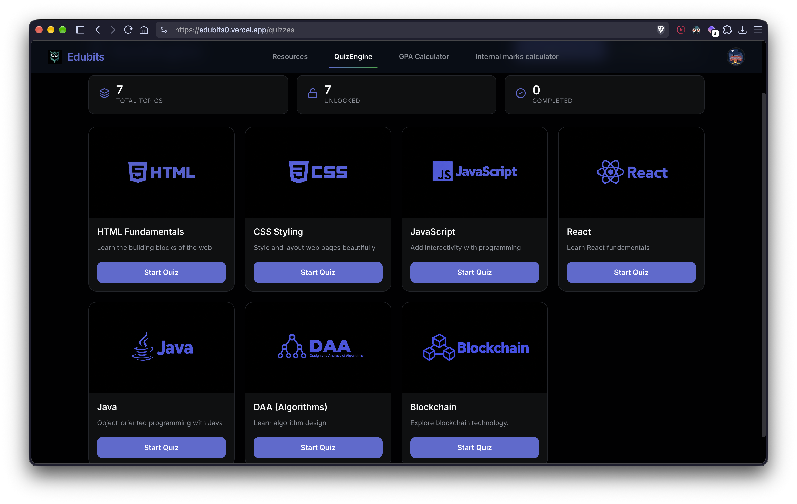
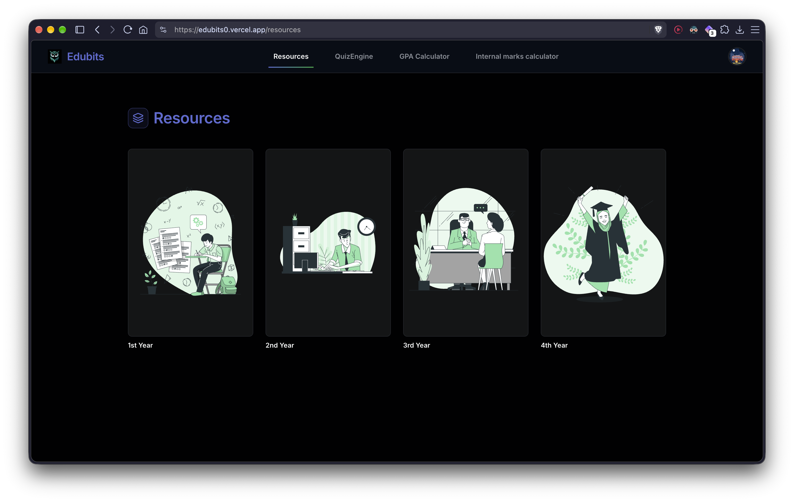
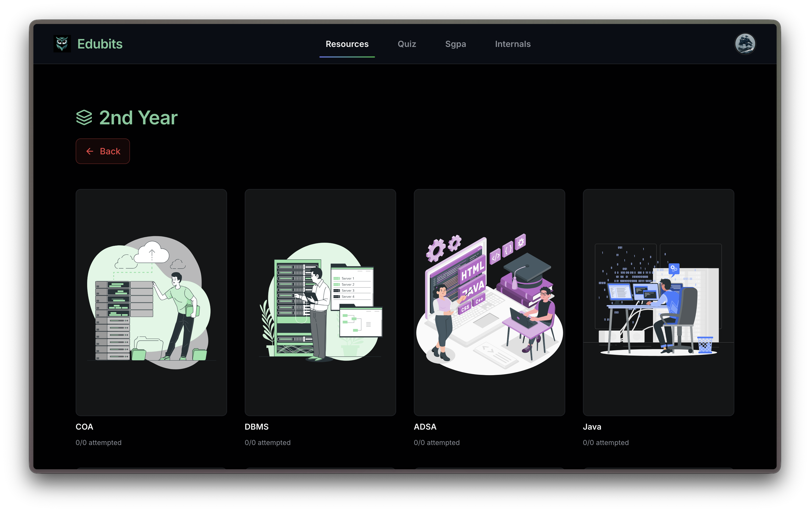

<div align="center">


# Edubits

Your engineering toolkit, all in one place.

Grade calculators, exam resources, practice quizzes, task tracking, and tools for the rest of engineering life.

[Explore the source](https://github.com/Imdilshan/edubits)

</div>

<br />

Edubits is a student-built workspace for engineering students. It brings everyday academic tools together so you can spend less time switching between spreadsheets, drives, and scattered notes.

The app includes a React web client and an Express API. Its source is available in this repository, and you can run it locally or deploy your own instance.

<br />

## QuizEngine



Practice topic-based multiple choice quizzes, follow prerequisite paths, and review your results. Quiz progress, history, and scores are tied to your account.

<br />

## Exam resources



Browse previous year papers, solutions, notes, and playlists by year and subject. Resource files are stored in Cloudinary, with resource metadata and progress in MongoDB.

<br />

## Previous year papers



Find question papers and solutions in one place, and keep track of the papers you have attempted.

<br />

## Tools for the semester

- **SGPA and CGPA calculators** — calculate semester grades and explore CGPA goals.
- **Internal marks calculator** — work out marks across different subject formats.
- **Task tracker** — organize assignments and projects by status, priority, and deadline.
- **UG Life Tracker** — keep a semester calendar, weekly reflections, and personal progress.
- **Programming roadmap** — move through topics and track problem-solving progress.

Calculators and the UG Life Tracker save their data in your browser. Tasks, quiz progress, and programming progress are stored in your Edubits account.

<br />

## Get started

The backend and frontend are installed and run separately.

### Backend

```bash
cd backend
npm install
cp .env.example .env
```

Set the required values in `backend/.env`:

```env
NODE_ENV=development
PORT=5001
MONGO_URI=mongodb+srv://<username>:<password>@<cluster>.mongodb.net/Edubits
JWT_SECRET=<random secret of at least 32 characters>
FRONTEND_URL=http://localhost:5173
CLOUDINARY_CLOUD_NAME=<your cloud name>
CLOUDINARY_API_KEY=<your API key>
CLOUDINARY_API_SECRET=<your API secret>
```

Generate a JWT secret with `openssl rand -base64 32`. Keep real values in `.env`; do not commit them. Optional Google and GitHub OAuth credentials are listed in [`backend/.env.example`](backend/.env.example).

Start the API:

```bash
npm run dev
```

### Frontend

In a second terminal:

```bash
cd frontend
npm install
cp .env.example .env
npm run dev
```

Open the local address printed by Vite, usually `http://localhost:5173`.

<br />

## Deploying

- **Frontend:** deploy `frontend/` to Vercel. Set the Vercel project environment variable `BACKEND_URL` to the public HTTPS origin of the backend.
- **Backend:** deploy `backend/` to a Node.js host and configure the required environment variables there. Set `NODE_ENV=production` and `FRONTEND_URL` to the exact deployed frontend origin. If OAuth is enabled, also set the backend's `BACKEND_URL` to its public HTTPS origin.
- **Database and files:** provide a MongoDB database and Cloudinary credentials. Production MongoDB connections use TLS.
- **OAuth:** if enabled, configure the provider callback URLs as `https://<your-frontend-domain>/api/auth/google/callback` and `https://<your-frontend-domain>/api/auth/github/callback`.

The backend refuses to start when required credentials are missing or still contain example placeholders. See [`backend/.env.example`](backend/.env.example) and [`frontend/.env.example`](frontend/.env.example) for the full variable lists.

<br />

## How authentication works

Edubits supports email and password accounts, plus optional Google and GitHub sign-in. Passwords are hashed before storage. The session is held in an HTTP-only cookie; logout and password changes revoke previous sessions.

Admin actions are checked by the API. Hiding an admin screen in the frontend is not used as the authorization check.

<br />

## Tech stack

- **Frontend:** React, Vite, React Router, Axios
- **Backend:** Express, Mongoose, MongoDB
- **Authentication:** bcrypt, JWT, Passport OAuth
- **File storage:** Cloudinary
- **Hosting:** Vercel for the frontend; any supported Node.js host for the backend

<br />

## Development commands

```bash
# Frontend
cd frontend
npm run lint
npm run build
```

```bash
# Backend (from the repository root in another terminal)
cd backend
npm run dev
npm run seed:quiz       # Optional: load quiz content
npm run seed:resources  # Optional: create resource placeholders
```

There is no automated test suite configured yet.

<br />

## Contributing

Edubits is built by students, for students. Issues, ideas, and pull requests are welcome. For code changes, run `npm run lint` and `npm run build` from `frontend/` before opening a pull request.

## Community and support

Open an issue or contact the maintainers through the [Edubits GitHub repository](https://github.com/Imdilshan/edubits).

## Security

Please report security concerns to the maintainers through GitHub before publishing details in a public issue. If you are upgrading from an older version, check whether an account created by the former seed setup still exists and rotate its credentials. Any real secret previously committed must be rotated; deleting it from the current files does not remove it from Git history.

## License

The backend package declares ISC in [`backend/package.json`](backend/package.json). There is no repository-level `LICENSE` file yet.

---

Built by a student, for students. Every tool started with a problem I needed to solve.
